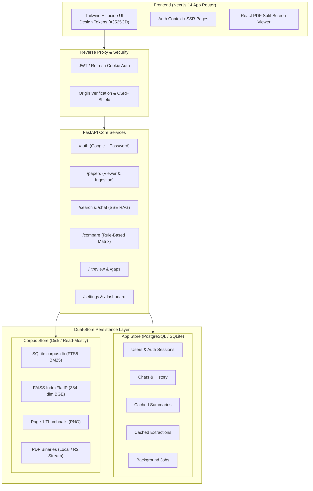
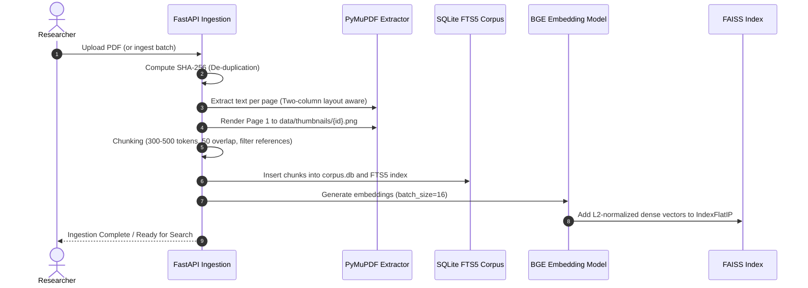

# ResearchMate System Architecture

ResearchMate is a full-stack, local-first scientific paper research assistant designed to operate efficiently on consumer hardware (e.g., 8 GB RAM, 4-core CPU, with optional CUDA acceleration) while providing strict citation grounding, multi-tenant session isolation, and dual-store persistence.

---

## 1. High-Level Architecture Overview

---

## 2. Key Architectural Pillars

### A. Dual-Store Persistence
1. **App Store (`data/app.db` dev | PostgreSQL prod)**:
   - Manages relational state requiring concurrent read/writes, ACID transactions, and foreign-key integrity: `users`, `refresh_tokens`, `chats`, `messages`, `summaries`, `extractions`, `jobs`, `llm_calls`.
   - Built with SQLAlchemy ORM and managed via Alembic migrations.
2. **Corpus Store (`data/corpus.db` + `data/faiss/`)**:
   - Stores immutable document chunks, PyMuPDF two-column block text, and the FTS5 full-text index.
   - Vector index is a self-contained FAISS `IndexFlatIP` storing normalized 384-dimensional dense vectors from `BAAI/bge-small-en-v1.5`.
   - **Advantage**: The entire corpus and vector index built locally on a development machine can be transferred via `rsync`/`scp` directly to a production VPS without database dump/restore cycles.

### B. Strict Citation Grounding Engine
- **Extractive Card Mode (`LLM_PROVIDER=none`)**: When no external LLM is configured or keys are absent, ResearchMate operates in 100% free local extractive mode. Queries return ranked numbered evidence cards with exact verbatim quotes and page numbers, eliminating hallucination.
- **RAG Grounding**: When an LLM is active, the prompt injects only numbered context passages and instructs the model to answer exclusively from the context with `[n]` citations.
- **Sanitization Pass**: The backend verifies every citation token `[n]`; any citation referencing a passage out of range is systematically stripped before streaming to the client.

---

## 3. Ingestion & Indexing Pipeline

---

## 4. Hybrid Retrieval Architecture (BM25 + Dense + RRF)

Retrieval uses Reciprocal Rank Fusion (RRF) to combine keyword lexical matching with semantic dense search:

$$\text{RRF Score}(d) = \frac{1}{k + \text{rank}_{\text{BM25}}(d)} + \frac{1}{k + \text{rank}_{\text{Vector}}(d)}$$

where $k=60$.

1. **BM25 Search**: Evaluates lexical tokens using SQLite FTS5 with BM25 ranking.
2. **Dense Vector Search**: Queries the FAISS index with inner product search over unit-normalized embeddings (cosine similarity).
3. **Visibility Filtering**: Results are filtered to ensure private documents belonging to other users are never returned.
4. **Cross-Encoder Reranker**: Optionally re-scores top candidates using `cross-encoder/ms-marco-MiniLM-L-6-v2` when memory permits (`USE_RERANKER=true`).

---

## 5. Comparison & Comparability Engine

The comparison engine operates on structured extraction records:

$$\text{Record} = \{\text{task}, \text{dataset}, \text{metric}, \text{value}, \text{unit}, \text{conditions}, \text{source}\}$$

- **Zero Conversion Rule**: Numbers are never converted or inferred.
- **Rule-Based Comparability**: Two records are directly comparable if and only if:
  1. `task`, `dataset`, and `metric` match identically.
  2. `unit` matches (or can be proven equivalent without loss of precision).
  3. `conditions` (hardware, model size, training dataset, shots) do not conflict.
- Records failing any condition are placed into a **"Not directly comparable"** category with explicit reasons displayed in the UI.

---

## 6. Multi-Tenant Security & Isolation

- **Authentication**: JWT access tokens (30 min) + rotating refresh tokens (14 days, stored as SHA-256 hashes in DB) in `HttpOnly`, `Secure`, `SameSite=Lax` cookies.
- **Paper Visibility**:
  - `shared`: Accessible by all authenticated users across the library.
  - `private`: Accessible strictly by `owner_id`. Any attempt by another user to view details, stream PDF bytes, or access summaries is rejected with `403 Forbidden`.
- **Chat Isolation**: Chats and message histories are scoped strictly to `user_id`. Queries to other users' sessions return `404 Not Found`.
- **OAuth Safety**: Google Sign-In validates `email_verified` and audience tokens using Google Auth verification libraries.
