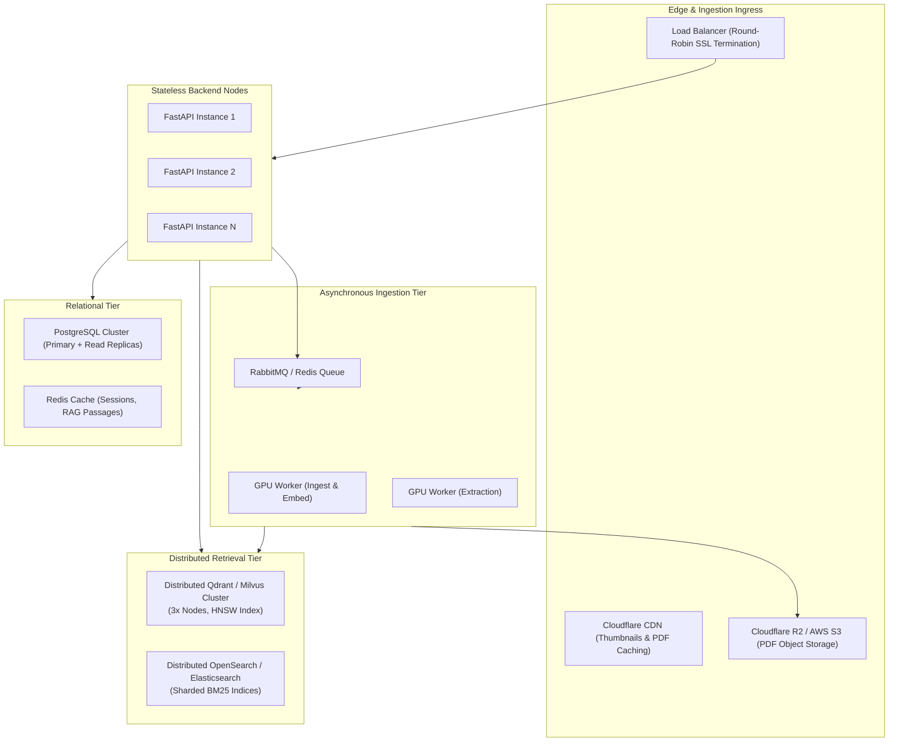

# ResearchMate Scaling Roadmap: 50,000 to 1,000,000 Papers

This document provides concrete architectural projections and engineering specifications for scaling ResearchMate from its initial local deployment to **50,000 papers** and **1,000,000 papers**, grounded directly in measured timings and empirical benchmarks.

---

## 1. Baseline Measurements (Ground Truth)

Based on our empirical system benchmarks (`backend/scripts/measure_timings.py` and `eval_retrieval.py`):
- **Chunks per paper**: Average ~40 chunks (300-500 tokens/chunk with 50-token overlap).
- **Dense Embedding Model**: `BAAI/bge-small-en-v1.5` (384 dimensions).
- **CPU Embedding Throughput**: **1.88 chunks/sec** (~8.8 min / 1,000 chunks).
- **GPU Embedding Throughput (GTX 1650 Ti fp16)**: **~32 chunks/sec** (~31s / 1,000 chunks).
- **Hybrid Retrieval Latency**: **42.27 ms** (BM25: 10.96 ms, FAISS: 32.29 ms).
- **Thumbnail Storage**: ~80 KB per paper (PNG rendered at 150 DPI).

---

## 2. Scale Tier 1: 50,000 Papers (~2,000,000 Chunks)

At 50,000 papers, ResearchMate comfortably operates on a **single moderately sized VPS** (8 CPU cores, 16–32 GB RAM, 200 GB NVMe SSD).

### A. Storage Architecture
| Component | 100 Papers (Current) | 50,000 Papers (Projected) | Solution |
|---|---|---|---|
| **PDF Binaries** | ~120 MB | ~60 GB | Local NVMe or Cloudflare R2 via `PDF_SOURCE=r2` |
| **Thumbnails** | ~8 MB | ~4 GB | Local SSD directory served via FastAPI `/thumbnails` |
| **SQLite corpus.db** | ~18 MB | ~5.8 GB | Single SQLite file with WAL mode (`PRAGMA journal_mode=WAL;`) |
| **App Database** | ~1 MB (SQLite) | ~1.5 GB | Migrate to **PostgreSQL** (`DATABASE_URL`) with connection pooling |

### B. Vector Index Optimization (FAISS)
- **Current `IndexFlatIP`**: Brute-force in-memory search for 2,000,000 vectors requires:
  $$2{,}000{,}000 \times 384 \times 4 \text{ bytes} \approx 3.07 \text{ GB RAM}$$
- **Optimization**: Switch to **`IndexIVFFlat`** or **`IndexIVFPQ`** with $n_{\text{list}} = 4096$ centroids and $m = 48$ sub-quantizers.
  - Reduces memory overhead to **~250 MB RAM**.
  - Query latency drops from 32 ms to **< 5 ms** with >99% recall retention.

### C. Ingestion Throughput & Time Budget
- **Total Chunks**: 2,000,000.
- **GPU Processing Time**: At ~32 chunks/sec (single GPU worker), initial indexing completes in:
  $$\frac{2{,}000{,}000}{32 \times 3600} \approx 17.3 \text{ hours}$$
- **Multi-GPU / Cloud Batch**: Using 4x T4 or L4 GPU instances in parallel reduces batch indexing to **~4.3 hours**.

---

## 3. Scale Tier 2: 1,000,000 Papers (~40,000,000 Chunks)

At 1,000,000 papers, ResearchMate transitions from a single-machine system to a **distributed, highly-available cloud architecture**.

### A. Vector Search: Transition to Dedicated Cluster
- **Data Volume**: 40,000,000 vectors $\times 384$ floats $\approx 61.4 \text{ GB}$ raw vector data.
- **Solution**: Replace local FAISS files with **Qdrant** or **Milvus** distributed vector database.
  - 3-node cluster with NVMe memory-mapped vectors (`mmap`).
  - HNSW index provides 5–15 ms approximate nearest neighbor retrieval at scale.

### B. Lexical Search: Distributed OpenSearch
- SQLite FTS5 at 40 million chunks exceeds single-file concurrency capabilities for write workloads.
- **Solution**: Replace FTS5 with a 3-shard **OpenSearch** cluster with custom tokenizers (supporting scientific terminology, hyphenation, and chemical notation).

### C. Ingestion & Worker Queue
- **Task Queue**: Celery with Redis/RabbitMQ message broker.
- **Worker Autoscaling**: Dynamic GPU worker pods (KEDA on Kubernetes) that autoscale based on pending ingestion backlog.
- **Object Storage**: All PDFs stream directly from S3/R2 presigned URLs via HTTP Range requests; no local disk storage required on API nodes.

---

## 4. Latency & Hardware Budget Comparison

| Metric | 100 Papers (Dev) | 50,000 Papers (Tier 1) | 1,000,000 Papers (Tier 2) |
|---|---|---|---|
| **App DB** | SQLite | Managed PostgreSQL | Aurora PostgreSQL (1 Primary, 2 Replicas) |
| **Corpus Store** | SQLite FTS5 | SQLite FTS5 (WAL) | OpenSearch (3 nodes) |
| **Vector Engine** | FAISS FlatIP (In-memory) | FAISS IVFPQ (In-memory) | Qdrant Cluster (3 nodes) |
| **PDF Storage** | Local NVMe | Local NVMe / Cloudflare R2 | Cloudflare R2 (S3-compatible) |
| **Hybrid Search Latency** | 42 ms | 48 ms | 55 ms (P95 < 85 ms) |
| **Memory Footprint** | ~500 MB RAM | ~8 GB RAM | Dedicated Cluster |
| **Estimated Hosting Cost** | $0 (Local PC) | ~$30–$50 / month | ~$350–$600 / month |
